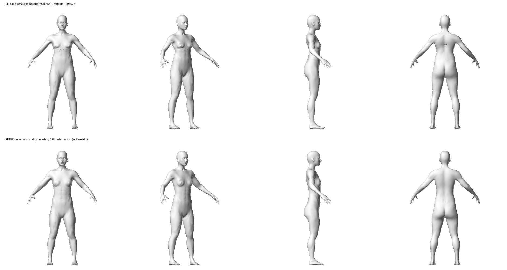

# 3D 人偶变形回归

对照基线为 `120e07e`，使用仓库现有的男女 OBJ，未替换人物资产。

## 复现与修复

| 问题 | 修复前实测 | 本次处理 |
| --- | --- | --- |
| 身高重复缩放、脚底下沉 | 女性设 180 cm，模型高 202.54 cm，脚底 -11.71 cm；男性设 195 cm，模型高 218.19 cm，脚底 -12.24 cm | 以同身高的中性档案算比例，身高只应用一次；关节链从脚底累计并归一化 |
| 头部、手指被无关参数拉坏 | 68 组边界测试中，最大局部边拉伸离群比 10.303 | 去除混入其他肢体的半径统计与无限延伸的体段评分，使用局部权重；头、手、脚保留参考形状 |
| 胸背裂纹、关节折痕 | 女性躯干长度设 58 cm 可见胸背裂纹 | 缓存并沿拓扑平滑肩部权重；各长度段连接，围度连续插值 |
| 服装留在旧体型 | 网格模式直接跳过衣服重建；加载完成也不重拟合 | 使用可更新包围体的 BVH 加速查询，体型更新和模型替换后重拟合衣服，保留颜色、尺寸、扣子、穿法 |
| 袖子轴线和截面不对应网格 | SDF 骨架代替网格关节，倾斜手臂使用水平截面 | 服装沿网格变形后的关节定位，袖子截面垂直手臂轴线 |
| 快速切换模型、退出页面 | 新请求被 loading 锁跳过；晚返回的旧网格可能覆盖当前模型或泄漏 | 页面与引擎请求序号检查；过期网格释放；退出时释放网格和阴影纹理 |
| 修改体型时缩放跳回 | 每次修改都重设相机距离 | 更新取景中心，保留用户缩放 |
| SDF 回退的腿长不一致 | 关节高度已归一化，但腿链仍减原始长度 | 膝和踝直接使用归一化关节高度 |

围度变形保留原网格的截面比例，替代此前方向性组织沉积启发式；本次没有引入精确人体测量或生理仿真模型。

## 验证

```bash
node tests/run.mjs --module '3D 网格回归'
pnpm typecheck
CI=1 pnpm build
```

- 68 组男女参数边界/组合用例通过，局部边拉伸离群比最大约 1.435，超过 1.8 的异常边为 0。审计脚本现在遇到异常会退出失败。
- 真实网格测试覆盖初次载入、中性形状、32 组高度/围度/骨长变形、脚底与身高、头部保护、复位无累积误差。
- 768 条射线与 Three.js 原始逐三角形求交结果对照，包括变形后、未命中、距离限制及父级旋转/非均匀缩放。
- 无 GPU 的引擎测试覆盖乱序响应、过期错误、销毁后返回、衣服状态保留及更新、相机缩放。
- 首轮修复时 Node 环境单件长袖衬衫连同身体重拟合约 21 ms；这是接缝重建前的观测，不能代表当前版本或手机帧率。

## 四视图

女性、默认体型、`torsoLengthCm=58`。上排修复前，下排修复后。由实际顶点经软件光栅化生成，正面、斜侧、侧面、背面。



可用现有 esbuild 与 Python 的 NumPy/Pillow 重现修复后的渲染：

```bash
# esbuild 是现有 Vite 依赖，可使用本机安装的 esbuild 命令或 pnpm 存储中的二进制。
esbuild scripts/export-mesh-case.ts --bundle --platform=node --format=esm --outfile=/tmp/cda-export.mjs
node /tmp/cda-export.mjs female torsoLengthCm 58 /tmp/cda-body.obj
python3 scripts/render-mesh.py /tmp/cda-body.obj /tmp/cda-body.png
```

## 验证边界

浏览器无法连接本地服务，未完成真实浏览器/手机 WebGL 的端到端验证。已检查实际网格的四视图及一件衬衫的几何渲染。

后续接缝修复已将上装衣片/袖子、裤装腰部/裆部连为连续网格，并完成领口收边，见 [服装接缝回归](garment-seam-regressions.md)。多层叠穿和极端体型的局部穿插仍需专项验证，不能保证任意衣物完全无穿模。没有新增绑骨骼多姿势、纹理或头发，也没有把边拉伸测试当作完整自相交证明。
