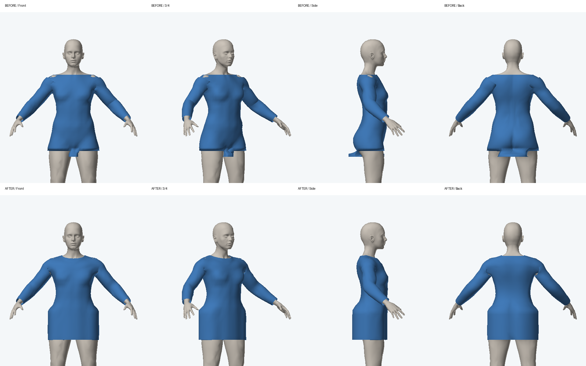
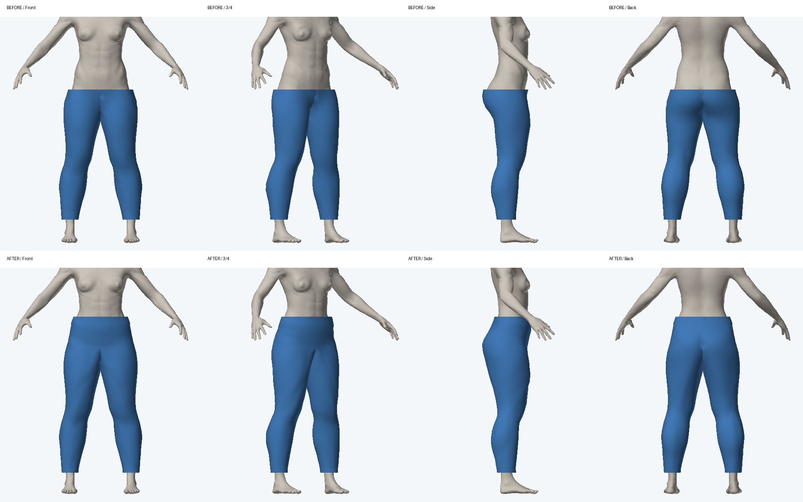

# 服装接缝回归

基线为 PR #2 首次提交 `0f52d22`（本地同树提交 `7e81378`），沿用现有男女 OBJ 与商品注册表。

## 修复内容

- 上装、外套的前后衣片、肩线与两只袖子共用连接顶点。袖山和腋下不再依赖三个独立圆筒相互遮盖；肩部法线随连续网格计算。
- 领口保留真实开口，领边、袖口、衣摆及前襟增加 1.2–2.5 mm 的内折收边。前襟有两条可分离的边，敞开/解扣时不会拉伸一块面跨过开口，扣好后两边坐标与法线一致。
- 袖子截面在肘部平滑转向。穿法使用身体坐标中的方向与高度，所有连接处共用同一次顶点位移；每次变化更新包围盒和包围球。
- 腰部和两条裤腿沿共用的弧形裆缝连接，去掉骨盆处两个圆筒的重叠。裤长控制裤脚位置，脚踝处设下限；围巾环带按环形索引闭合，去掉重复的纵向边界。
- 衣摆取髋部截面的包络，避免采样两腿间隙产生尖刺。平滑后重新检查贴合位置；平滑迭代不再每轮重复体表查询。

## 验证

```bash
node tests/run.mjs --module '服装接缝回归'
node tests/run.mjs --module '3D 网格回归'
pnpm typecheck
CI=1 pnpm build
```

- 290 组拓扑/穿法状态检查：男女 OBJ、SDF 回退、身高/体重及骨长边界、长短袖、无袖、裤长、围巾三种穿法。
- 每件衣物只有一个连通网格；连接边两侧面朝向一致，没有非流形边或退化三角形；只留下设计中的开口边界。
- 256 条躯干射线及 384 条腿部射线将人体和衣物三角面求交对照，检查默认男女体型下采样位置未穿入皮肤。该检查不等价于所有三角形自相交证明。
- 前襟闭合时重合，敞开后分离；切换穿法/扣子再复原时顶点完全恢复。既有人偶回归、类型检查和 H5 构建通过。
- 正面、斜侧、侧面、背面的 CPU 渲染检查，另检查男性上装及敞开穿法。
- 本机 Node 中身体连同一件长袖上装重拟合约 96 ms；移除平滑过程中的重复查询前约 253 ms。连续衣片拟合比原来的独立圆筒更昂贵，尚不能据此承诺手机端拖动帧率。

## 对比图

上排为修改前，下排为修改后，使用实际顶点、索引和法线生成。蓝色仅用于辨认衣物，界面中的颜色配置不变。





复现当前网格导出与渲染（使用已有 esbuild、NumPy、Pillow）：

```bash
esbuild scripts/export-garment-case.ts --bundle --platform=node --format=esm --outfile=/tmp/cda-garment.mjs
node /tmp/cda-garment.mjs female worn /tmp/shirt.json
node /tmp/cda-garment.mjs female open /tmp/open-shirt.json
node /tmp/cda-garment.mjs male worn /tmp/pants.json - - p_wide_trousers
# before.json 应由修改前的同一导出脚本生成
python3 scripts/render-garment.py /tmp/before.json /tmp/shirt.json /tmp/comparison.png
```

## 边界

本轮修复参数化衣物的结构接缝，不是布料物理或真实纸样系统。多层叠穿、极端组合体型的局部穿插，以及新姿势下的贴合仍需专项验证。手机端和真实浏览器 WebGL 尚未实测，CPU 几何渲染不能替代这些验证。
